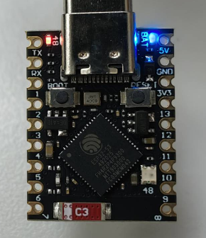

# SwitchNetBridge
ESP32 S3 for Nintendo Switch is made from VS Code with PlatformIO. 
It's ported from jackspence7's esp32-bridge.ino and use NAT to reach internet 
 
Switch <---> SwitchNetBridge (Filter DNS, Connection Test) <---> Normal Wireless AP <---> Internet
  

Requirement: 
01. ESP32 S3 4MB flash or more 
    Example: Waveshare ESP32-S3-Zero 
    
  

Usage:
01. Download release SwitchNetBridge_xxx.zip
02. Flash ESP32-S3 dongle with the tool and readme inside zip
03. Plug ESP32-S3 dongle to recycle power
04. Phone or PC WiFi connect to "SwitchNetBridge" SSID, default password is "password"
05. Use browser to http://192.168.4.1/dns
06. Change Relay AP password
07. Set Internet connection Wi-Fi SSID and password, this step can be ignored for LAN access only
08. Click "Save & Reboot"
09. Phone or PC WiFi connect to "SwitchNetBridge" SSID and use new password set on Step 6, make sure settings correct
10. Switch WiFi connect to "SwitchNetBridge"
11. Default block all internet domain name, add to Allow Domains if needed
  

Warning:
01. You try this at your own risk.
02. DO NOT ADD "nintendo" into Allow Domains.
 

Credits: 
。[jackspence7](https://github.com/jackspence7) - [CivSwitch-SerialBridge](https://github.com/jackspence7/CivSwitch-SerialBridge) 
